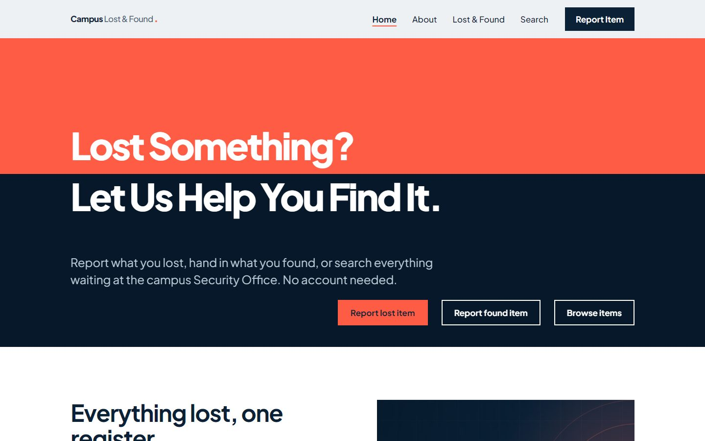
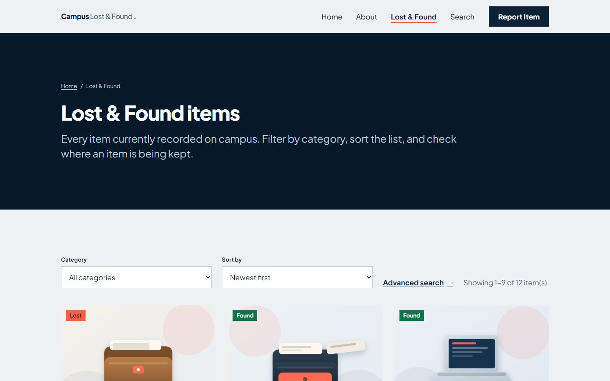
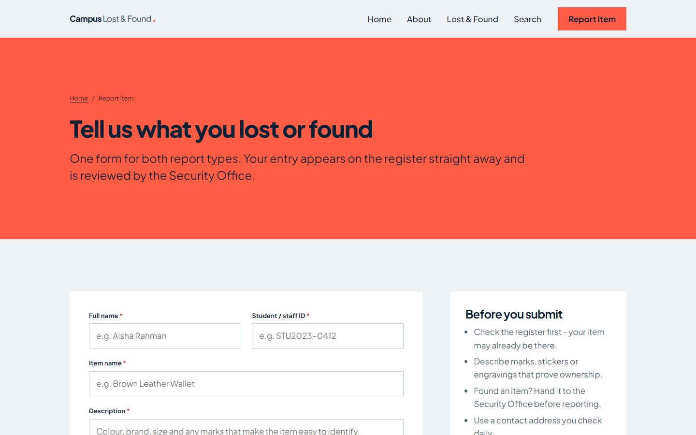
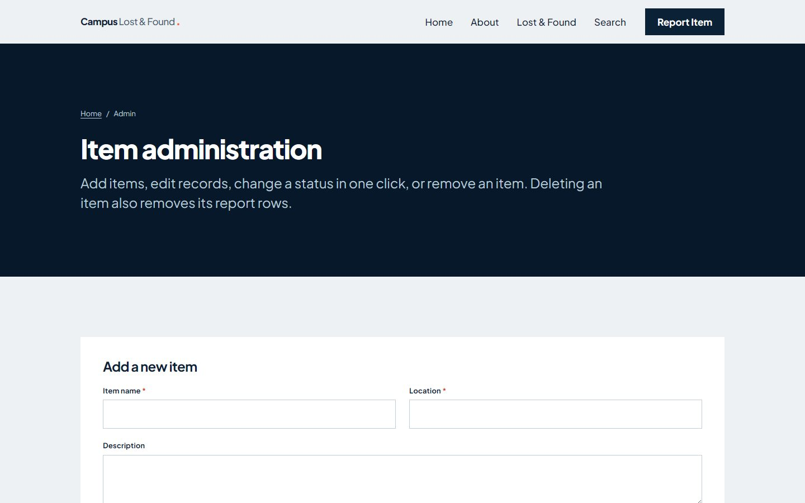

# Campus Lost & Found Portal

A lost-and-found register for a university campus. Students and staff report what they
lost, hand in what they found, and search a single register of everything waiting at the
Security Office. Built with ASP.NET Web Forms and SQL Server LocalDB for a group project.



## Quick start

If you already have Visual Studio and LocalDB, these four lines are the whole setup:

```powershell
git clone https://github.com/yezawtun-afk/Campus-Lost-Found.git
cd "Campus-Lost-Found"
sqlcmd -S "(localdb)\MSSQLLocalDB" -E -i "CampusLostFound\Database\LostFoundDB.sql"
start CampusLostFound.sln
```

Then press **F5** in Visual Studio. Everything else below is the slow, explained version.

## What it does

- **Report** a lost or found item, with an optional photo, in one form
- **Browse** every item in a card grid, filtered by category, sorted, and paged 9 at a time
- **Search** by keyword, category, location and status, in any combination
- **Manage** the register on an admin page: add, edit, delete, and change a status in one click
- **See** the four newest items on the home page, switchable between Lost, Found and Claimed

## Pages

| Page | Purpose |
| --- | --- |
| `Default.aspx` | Home: tagline, three calls to action, four recently reported items |
| `About.aspx` | Why the portal exists, how reporting works, and how to claim an item |
| `Items.aspx` | All items as cards, with category filter, sorting and pagination |
| `Search.aspx` | Keyword, category, location and status filters with a result count |
| `Report.aspx` | The report form, 10 fields, validation, photo upload |
| `Admin.aspx` | The register as an editable table, plus an add-item form |
| `Error.aspx` | Friendly error page, served by `<customErrors>` |

The Admin page is linked from the footer, not the main menu. There is no login, by design.

## Screens

**Items** - cards with Lost, Found and Claimed badges, filter and sort


**Report** - one form for both report types, with validation and photo upload


**Admin** - the register as an editable table, plus an add-item form


## Setup tutorial

Follow these steps in order. The first run takes about five minutes; after that you only
repeat step 5.

### Before you start

You need two things on the same computer:

1. **Visual Studio 2022 or newer** with the **ASP.NET and web development** workload.
   To check: open the *Visual Studio Installer*, find your installation, click **Modify**,
   and look for that workload ticked in the list.
2. **SQL Server Express LocalDB.** This is a small copy of SQL Server that runs only while
   you use it, so there is no server to start or configure. It is installed with the
   workload above. To check, open PowerShell and run:

   ```powershell
   sqllocaldb info
   ```

   If it prints a name such as `MSSQLLocalDB`, you are ready.

### Step 1 - Get the code

**With Git**, in PowerShell:

```powershell
cd $HOME\Desktop
git clone https://github.com/yezawtun-afk/Campus-Lost-Found.git
cd "Campus-Lost-Found"
```

**Without Git**: on the GitHub page, click the green **Code** button, then
**Download ZIP**, and extract it.

Either way you now have a folder containing `CampusLostFound.sln`. A path without
spaces or `&` is easier for the commands below, for example `C:\Projects\CampusLostFound`.
The project works from any folder; just use your own path in the next step.

### Step 2 - Create the database

The database does not exist yet. The script in `CampusLostFound\Database` creates it,
builds both tables, and adds 12 sample items with their reports.

**Option A - PowerShell (fastest).** Run this from the folder that contains
`CampusLostFound.sln`:

```powershell
sqlcmd -S "(localdb)\MSSQLLocalDB" -E -i "CampusLostFound\Database\LostFoundDB.sql"
```

`sqlcmd` is the command-line client for SQL Server. `-S` is the server to connect to,
`-E` means "use my Windows account", and `-i` is the file to run.

You should see this at the end:

```
TotalItems  TotalReports
----------- ------------
         12           12
```

If you see 12 and 12, the database is ready.

**Option B - SQL Server Management Studio.** Connect to `(localdb)\MSSQLLocalDB`, open
`CampusLostFound\Database\LostFoundDB.sql`, and press **Execute** (F5).

> The script drops and recreates `LostFoundDB`, so you can run it again at any time to
> reset the sample data.

### Step 3 - Open the solution

Double-click **`CampusLostFound.sln`**. Visual Studio opens it and shows the project in
the *Solution Explorer* on the right, with `Site.master`, the seven pages and `Web.config`
inside `CampusLostFound`.

If Visual Studio asks to install missing components, accept; they are part of the workload
from *Before you start*.

### Step 4 - Check the connection string

The app finds the database through one entry in `Web.config`:

```xml
<add name="LostFoundDB"
     connectionString="Data Source=(LocalDB)\MSSQLLocalDB;Initial Catalog=LostFoundDB;Integrated Security=True;MultipleActiveResultSets=True"
     providerName="System.Data.SqlClient" />
```

`Data Source` is the database server and `Initial Catalog` is the database name. The
values above match the script, so you normally do not touch this. If your database lives
on a different server, change those two values and nothing else.

### Step 5 - Run it

Press **F5**, or click the green **Start** button at the top. Visual Studio builds the
project, starts IIS Express (the small web server it ships with), and opens your browser.

The address should be **http://localhost:44300/**. If a different port appears, use the
address in the address bar; the port is a setting, not part of the app.

You should land on the home page: the tagline "Lost Something? Let Us Help You Find It."
sitting across a coral and navy seam, with three buttons beneath it.

To stop the site, close the browser tab and press the red **Stop** button in Visual Studio
(or **Shift+F5**).

### Step 6 - Check it works

Give yourself five minutes with these:

| Do this | You should see |
| --- | --- |
| Look at "Recently reported" on the home page | Four item cards with status badges |
| Click **Found** in that section | Only found items, and the coloured band changes |
| Go to **Search**, type `Wallet`, press Enter | "2 item(s) found", both wallets |
| Go to **Lost & Found**, click page 2 | Items 10 to 12 of 12 |
| Go to **Admin** from the footer, change a status | The badge updates immediately |
| On **Admin**, click Delete on a row | A confirmation dialog appears first |

That covers the database, the forms, the filters and the admin table.

### Running it again later

Open `CampusLostFound.sln` and press **F5**. The database is stored on your machine and
stays between runs. Run the script from step 2 only if you want to reset the sample data
or if you moved the project to another computer.

## Troubleshooting

| Symptom | Fix |
| --- | --- |
| "We could not connect to the database" | The database does not exist yet. Repeat step 2. |
| "Cannot open database LostFoundDB requested by the login" | Run the SQL script again while connected to `(localdb)\MSSQLLocalDB`. |
| `sqlcmd` is not recognised | Open a new PowerShell window after installing Visual Studio, or run it from the SQL Server tools folder. |
| The browser opens but the page is blank or shows an error | Check that step 2 printed 12 and 12, then reload. |
| An item shows a grey placeholder photo | Its image file is missing from `Images/items/`. The placeholder is expected. |
| A photo upload is rejected | Only JPG and PNG up to 4 MB are accepted. |
| F5 asks to configure IIS Express | Accept the defaults; the project's launch settings are already in `CampusLostFound.csproj`. |

## Tech stack

| Layer | Choice |
| --- | --- |
| Framework | ASP.NET Web Forms, .NET Framework 4.8 |
| Language | C# |
| Database | SQL Server Express LocalDB |
| Data access | ADO.NET (`SqlCommand` with parameters, `SqlDataAdapter`) |
| Front end | One master page, one stylesheet, plain HTML/CSS and a small JS file |
| Tooling | Visual Studio 2022 or newer, IIS Express |

## Database

Two tables, one relationship.

| Table | Columns |
| --- | --- |
| `Items` | `ItemID` identity key, `ItemName`, `Description`, `Category`, `Location`, `DateReported`, `Status` (Lost / Found / Claimed, with a CHECK constraint), `ImagePath`, `ContactInfo` |
| `Reports` | `ReportID` identity key, `ItemID` foreign key to `Items` with `ON DELETE CASCADE`, `ReporterName`, `StudentStaffID`, `ReportType` (Lost / Found), `ReportDate` |

`Report.aspx` writes both rows inside one `SqlTransaction`, so an item is never saved
without its report. Deleting an item on the admin page removes its report rows too.

## Project structure

```
Campus Lost & Found/
  CampusLostFound.sln          Visual Studio solution
  docs/                        screenshots used by this README
  CampusLostFound/
    Site.master                shared header, navigation and footer
    Content/Site.css           the whole design system
    Content/site.js            page fades and the home status switch
    Default.aspx               home
    About.aspx                 about and how it works
    Items.aspx                 browse, filter, sort, page
    Search.aspx                search
    Report.aspx                report form
    Admin.aspx                 admin table and add form
    Error.aspx                 custom error page
    DbHelper.cs                connection + query helpers
    Database/LostFoundDB.sql   schema and 12 sample items
    Images/                    hero, about, placeholder and item photos
    Web.config                 connection string and customErrors
    README.txt                 the same instructions as plain text
```

All database access goes through `DbHelper.cs` and uses parameterised queries, so the
pages are safe from SQL injection.

---

Built as a group project. No login or authentication is used.
